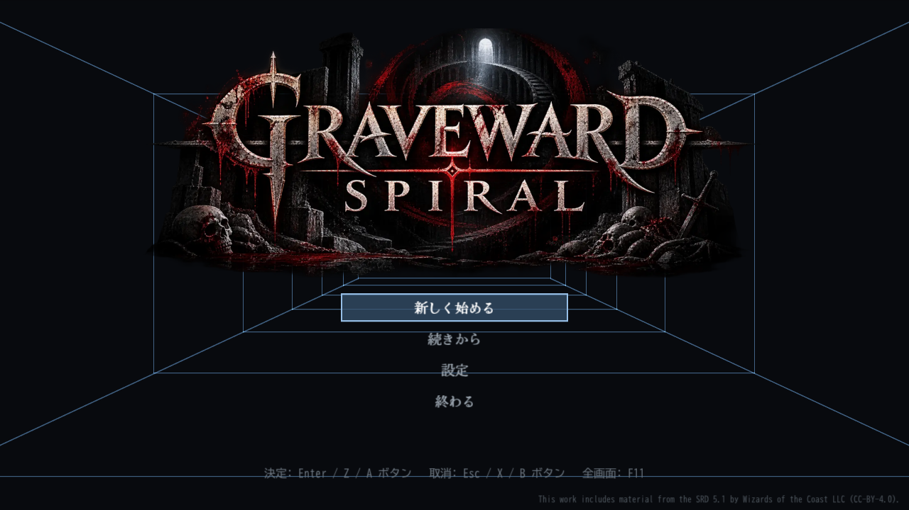
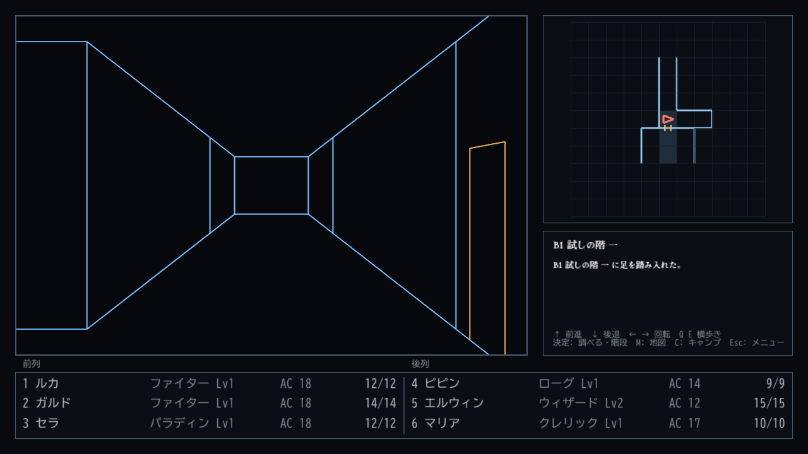
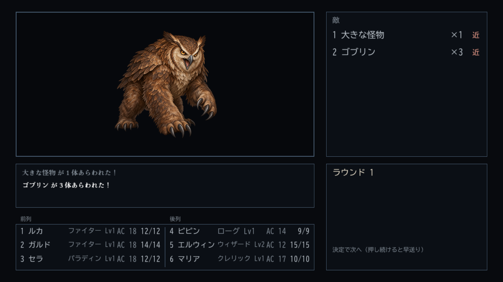
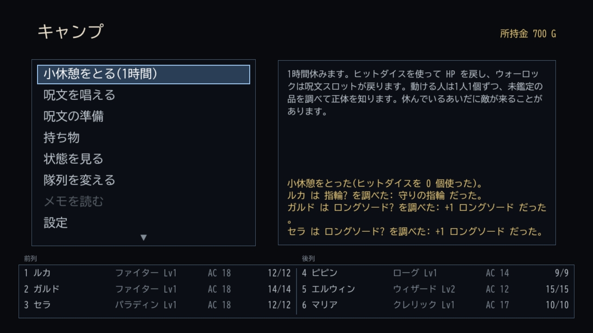
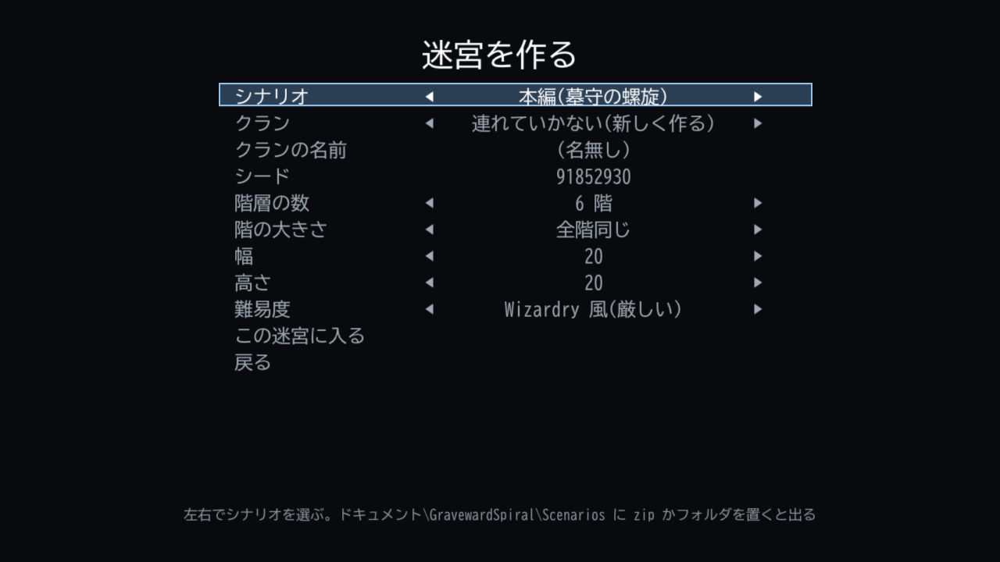
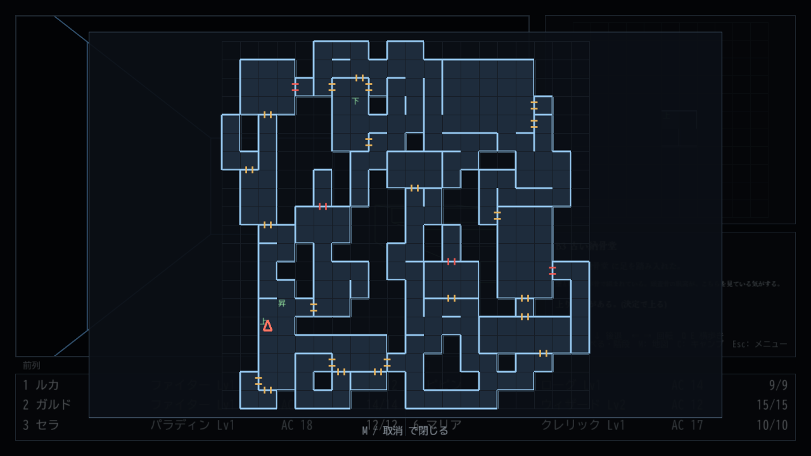
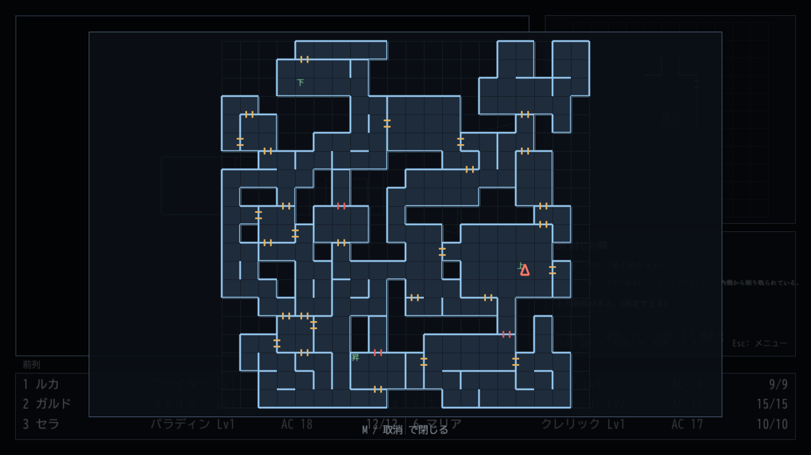

# GRAVEWARD SPIRAL

初代 Wizardry 風の、線画の疑似 3D ダンジョン RPG です。ルールは D&D 第5版の SRD 5.1 に合わせています。

A first-person, wireframe dungeon crawler in the style of the original Wizardry, built on the D&D 5th edition SRD 5.1 rules.

> 画面は日本語と英語に対応しています(設定の「言語」で切り替え)。下の画面写真は日本語です。
>
> **English is fully supported.** The screenshots below are in Japanese; switch the language under Options → Language.



| 迷宮 / Maze | 戦闘 / Combat |
|---|---|
|  |  |



## 毎回ちがう迷宮 / A new dungeon every game

新しいゲームを始めるたびに、シードから全部の階を作ります。部屋と通路、扉と隠し扉、一方通行、回転床やテレポーター、暗闇と霧を置き、町から最下層まで行って戻れるかを確かめてから遊べるようにします。同じシードなら同じ迷宮です。階の数と大きさも選べます。敵の顔ぶれ、宝、イベント、名のある敵も世界ごとに抽選します。

Every new game builds the whole dungeon from a seed: rooms and corridors, doors and secret doors, one-way passages, spinners and teleporters, darkness and fog. Each dungeon is checked to be fully reachable, from town to the bottom floor and back. The same seed always gives the same dungeon, and you choose the number and size of floors. Monsters, treasure, events and named foes are rolled for each world, too.

| 新しいゲーム / New game | 生成した階の例 / Generated floors |
|---|---|
|  |  |
| |  |

## 三部作のシナリオ / The trilogy

決まった迷宮と物語のあるシナリオを3つ入れています。同じクランで、第1部から順に遊べます。

Three scenarios with handmade dungeons and stories are included. One clan can play them in order.

| | シナリオ / Scenario | レベル / Levels |
|---|---|---|
| 第1部 / Part 1 | 墓守の螺旋 / The Gravekeeper's Spiral | 1–5 |
| 第2部 / Part 2 | 沈んだ王都 / The Sunken Capital | 5–8 |
| 第3部 / Part 3 | 冒険者を食う迷宮 / The Devouring Labyrinth | 8–13 |

## 遊ぶ / Play

[Releases](../../releases) から `GravewardSpiral-Setup-<版>.exe` を落として、インストールしてください(Windows 64bit。.NET を入れる必要はありません。管理者の権限も要りません)。セーブは `%LOCALAPPDATA%\GravewardSpiral` に残り、アンインストールしても消えません。

Download `GravewardSpiral-Setup-<version>.exe` from [Releases](../../releases) and install it (Windows 64-bit; no .NET install or admin rights needed). Saves live in `%LOCALAPPDATA%\GravewardSpiral` and survive uninstalling.

遊び方は [ヘルプ](HELP.md) にあります(ゲームの中の Esc のメニューの「ヘルプ」と同じ)。 / How to play: see the [Help](HELP.en.md) (the same as Help in the in-game Esc menu).

インストーラーには署名をしていないので、Windows が警告を出すことがあります。
- ブラウザ(Edge など)で「一般的にダウンロードされていません」などと出たら、「…」のメニューから「保存」(「保持する」)を選びます。
- 起動したときに青い画面で「Windows によって PC が保護されました」と出たら、「詳細情報」を押してから「実行」を押します。

The installer is not signed, so Windows may warn you.
- If your browser (Edge, for example) says the file "isn't commonly downloaded", choose "Keep" from the "..." menu.
- If a blue "Windows protected your PC" screen appears when you run it, click "More info", then "Run anyway".

## シナリオを作る / Make scenarios

インストーラーには、シナリオエディタ(スタートメニューの「GRAVEWARD SPIRAL シナリオエディタ」)も入っています。迷宮を描くか自動で作り、出る敵・ボス・イベント・物語の文・品やモンスターを決めて、そのまま試し遊びできます。作ったシナリオは `%LOCALAPPDATA%\GravewardSpiral\Scenarios` に保存され、ゲームの「新しいゲーム」で選べます。zip に書き出して配ることもできます。Claude の API キーを入れると、物語の文を AI に書かせることもできます(任意)。

The installer also includes the scenario editor ("GRAVEWARD SPIRAL Scenario Editor" in the Start menu). Draw or generate the dungeon, choose the monsters, bosses, events, story text, items and monsters, and play-test right away. Scenarios are saved to `%LOCALAPPDATA%\GravewardSpiral\Scenarios` and appear under New Game; you can also export them as zip files to share. With a Claude API key, the AI can write the story text (optional).

## 作る / Build

.NET 10 SDK が要ります。 / Requires the .NET 10 SDK.

```
dotnet run --project src/GravewardSpiral.Game
dotnet run --project tools/GravewardSpiral.Editor
dotnet test
```

インストーラーは `python tools/make_installer.py --version X.Y.Z`(Inno Setup 6 が要ります)。

To build the installer: `python tools/make_installer.py --version X.Y.Z` (requires Inno Setup 6).

## 中身 / Layout

| フォルダ | 中身 |
|---|---|
| `src/GravewardSpiral.Core` | ルールとデータ(描画に依存しない) / Rules and data |
| `src/GravewardSpiral.Game` | MonoGame の画面・入力・音 / Screens, input and audio |
| `Content/` | コンテンツパック(SRD のデータ、イベント、絵、音) / Content packs |
| `tests/` | xUnit のテスト / Tests |
| `tools/GravewardSpiral.Editor` | シナリオエディタ(WPF) / Scenario editor |
| `tools/` | 戦闘のシミュレータ、迷宮の確認、データの変換、インストーラー / Tools |

## ライセンス / License

- ソースコード(`src/`、`tests/`、`tools/`): [MIT](LICENSE)
- 素材(絵、音楽、物語の文、ロゴ)など: [LICENSE-ASSETS.md](LICENSE-ASSETS.md)
- SRD 5.1 に由来するデータ: CC-BY-4.0。クレジットは [Content/CREDITS.txt](Content/CREDITS.txt)

This work includes material taken from the System Reference Document 5.1 ("SRD 5.1") by Wizards of the Coast LLC, licensed under the Creative Commons Attribution 4.0 International License.
